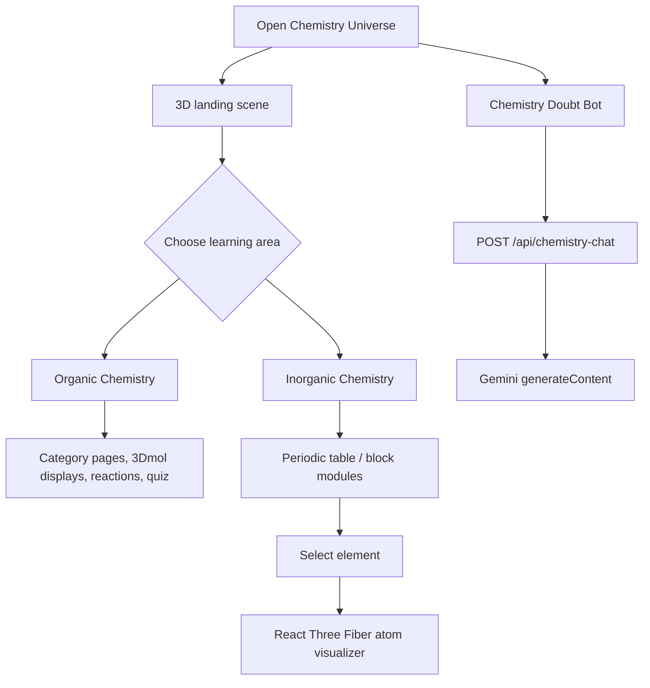

# Chemistry Universe in 3D — Project Overview

## What this repository builds

Chemistry Universe is a browser-based chemistry learning application with a shared entry point and two learning areas:

- **Organic Chemistry** (`/organic/*`): category-based lessons, reactions, conversions, physical properties, molecule displays, quiz UI, and reaction narration.
- **Inorganic Chemistry** (`/inorganic/*`): a periodic table, selected-element atomic visualizer, periodic trends, s/p/d/f block learning modules, static molecular/compound renderings, quiz UI, and narration.

The root application owns the landing screen, top-level routing, the floating Chemistry Doubt Bot, and the production chat API. It imports source files directly from `organic-chemistry-visualizer/` and `periodic table/`; those folders also contain older standalone Vite projects, but the root `package.json` is the build target used by `npm run dev` and `npm run build`.

## Verified entry points

| Concern | Active root implementation | Evidence |
|---|---|---|
| Browser entry | `src/main.jsx` → `src/App.jsx` | Root `index.html` loads `/src/main.jsx`. |
| Landing page | `src/components/ChemistryUniverseHome.jsx` | Route `/`. |
| Organic integration | `src/integrations/OrganicPlatform.jsx` | Route `/organic/*`; imports organic source components. |
| Inorganic integration | `src/integrations/InorganicPlatform.jsx` | Route `/inorganic/*`; renders `periodic table/src/App.tsx`. |
| Chat UI | `src/components/ChemistryDoubtBot.jsx` | Rendered outside `<Routes>` in root `App.jsx`. |
| Production chat handler | `api/chemistry-chat.js` + `api/chemistryChatCore.js` | Vercel-style API handler. |
| Local chat handler | Vite plugin in `vite.config.js` | Mounts `POST /api/chemistry-chat` during `npm run dev`. |

## User-visible journey

## Languages actually present

- **JavaScript / JSX**: root app, root API, organic source tree, legacy Express server.
- **TypeScript / TSX**: inorganic source tree, with strict TypeScript configuration in `periodic table/tsconfig.json`.
- **CSS**: root and subproject stylesheets, primarily utility classes generated by Tailwind plus custom CSS.
- **JSON**: package lockfiles and several organic molecular coordinate/result files.
- **HTML**: Vite host pages.

## Scope and verification notes

This documentation is based on source/configuration inspection. It intentionally does not print environment-variable values or other secrets. A dependency listed in a subproject package file is not described as active unless the source or root build demonstrates use. “Legacy” means the code is present and runnable separately, not necessarily that it is obsolete by design.

See the remaining numbered documents for implementation-level detail.
