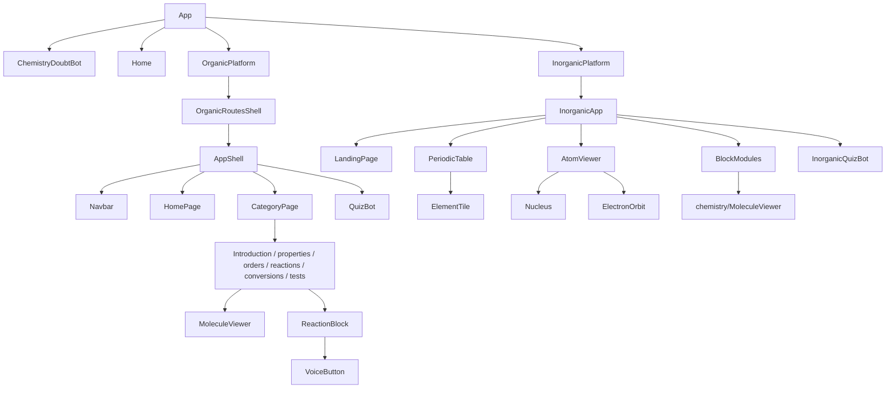
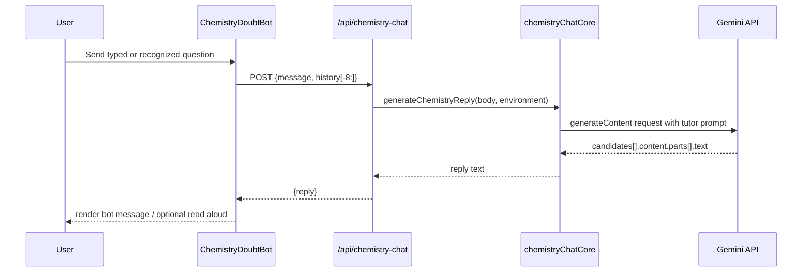

# System Architecture

## Composition model

The repository is not a monorepo workspace with a package-manager workspace file. Instead, the root Vite app directly imports source files from two sibling folders. `vite.config.js` allows parent filesystem access and explicitly aliases/deduplicates React, router, Framer Motion, Three and R3F packages so imported components resolve to the root dependency graph.

```mermaid
flowchart LR
  Browser --> HTML[index.html]
  HTML --> Main[src/main.jsx]
  Main --> RootApp[src/App.jsx]
  RootApp --> Home[ChemistryUniverseHome]
  RootApp --> Bot[ChemistryDoubtBot]
  RootApp --> Organic[OrganicPlatform]
  RootApp --> Inorganic[InorganicPlatform]
  Organic --> OSource[organic-chemistry-visualizer/src]
  Inorganic --> ISource[periodic table/src]
  Bot --> ChatRoute[/api/chemistry-chat]
  ChatRoute --> Core[generateChemistryReply]
  Core --> Gemini[Google Gemini REST API]
```

## Routing architecture

| URL | Renderer | Routing mechanism |
|---|---|---|
| `/` | `ChemistryUniverseHome` | Root React Router route. |
| `/organic` | Organic `HomePage` in `AppShell` | `OrganicPlatform` contains nested `Routes`; category slug is optional child path. |
| `/organic/:categorySlug` | Organic `CategoryPage` | `useParams()` chooses chemistry-content category. |
| `/inorganic` | Inorganic `LandingPage` | Internal state in `periodic table/src/App.tsx`, derived from `window.location.pathname`. |
| `/inorganic/periodic-table` | `PeriodicTable` | Inorganic state view. |
| `/inorganic/s-block`, `/p-block`, `/d-block`, `/f-block` | Block module components | Inorganic state view. |
| `/periodic-table` | Redirect to `/inorganic/periodic-table` | Root React Router redirect. |

Organic and root routing use React Router. The inorganic component is rendered inside a React Router page but manages its own path with `history.pushState`, `popstate`, `pathToView`, and `viewToPath`; it does not declare React Router routes.

## Component hierarchy



## API architecture



During local development, a Vite middleware handles the route. In a Vercel deployment, `api/chemistry-chat.js` handles it. Both call the same core function, so prompt construction, timeout, API-key lookup and fallback model handling are shared.

## Data flow

- Root home scene is procedural JSX geometry; it does not fetch molecule data.
- Organic categories/data are JavaScript exports in `organic-chemistry-visualizer/src/data/chemistryContent.js`, passed as props into lesson components.
- Organic molecule displays use in-memory XYZ strings in `moleculeModels`; standalone `.sdf` assets also exist, but inspected viewer code primarily consumes XYZ strings.
- Inorganic periodic data comes from `periodic table/src/data/elements.ts` as `ELEMENTS` records.
- Inorganic compound/molecule geometry is static typed data in `components/chemistry/MoleculeViewer.tsx`.
- AI responses are transient React state, not saved to a database.

## Failure boundaries/loading

- Root lazy routes use `Suspense`, `LoadingRoute`, and `RouteErrorBoundary`.
- Inorganic atomic scene is lazily imported and enclosed in `ErrorBoundary` with a WebGL-specific fallback.
- 3Dmol components catch script/viewer failures and display a small unavailable/error state.
- Chat uses `AbortController` timeout; UI falls back to predefined topical guidance if its API request fails.
