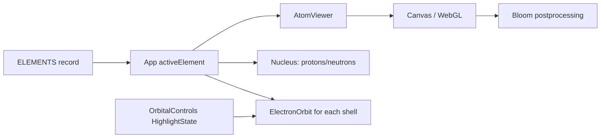

# 3D Visualization Deep Dive

## There are two real 3D pipelines

1. **Three.js through React Three Fiber (R3F)** renders the root decorative landing scene and inorganic atomic/compound scenes.
2. **3Dmol.js** renders organic molecular models and the inorganic compound molecule viewer. It is loaded as a browser global from `public/vendor/3Dmol-min.js`.

The npm package `3dmol` is declared, but inspected code does not `import` it. The actual implementation checks `window['3Dmol']` and dynamically inserts the vendor script when it is absent.

## Root landing: procedural R3F scene

`src/components/ChemistryUniverseHome.jsx` uses `<Canvas camera={...}>`. Children in the canvas are declarative Three objects:

- atom nucleus/electrons: `sphereGeometry` plus `meshStandardMaterial`;
- orbit rings: `torusGeometry`;
- benzene hexagon/DNA connections: Drei `<Line>`;
- labels: Drei `<Text>`;
- starfield: Drei `<Stars>`.

React creates the scene graph from JSX. R3F maps elements such as `<mesh>` and `<pointLight>` to Three.js objects. `useFrame(({ clock, pointer }) => ...)` runs on each render frame to mutate rotation/position. `useRef` retains mutable Three object references without forcing React renders. `Float` supplies subtle object motion.

## Inorganic atom visualizer

`periodic table/src/components/AtomViewer.tsx` creates the canvas and `Scene`. Its input is a `ChemicalElement` record and `HighlightState`.

- `Nucleus.tsx` samples a capped number of nucleon positions (maximum 45 for performance) and renders proton/neutron spheres, a pulsing wireframe energy shell and a point light. It is a pedagogical visual, not a physical simulation.
- `ElectronOrbit.tsx` calculates shell radius and elliptical paths. It creates orbit rings, electron meshes and glows; `useFrame` changes electron positions with elapsed time. `getSubshellType` from `utils/orbitHelpers.ts` assigns visual subshell categories used by highlight filtering.
- Drei `OrbitControls` enables drag rotation and wheel zoom. R3F’s postprocessing `EffectComposer` with `Bloom` creates the glow effect.
- `App.tsx` lazy-loads this viewer and wraps it in an error boundary; failure of the 3D canvas does not require the whole React application to fail.

## Inorganic compound renderer

`periodic table/src/components/chemistry/MoleculeViewer.tsx` contains typed static `MOLECULES` data. Each entry has atoms (`symbol`, `[x,y,z]`, optional charge/note), bonds (`from`, `to`, bond type) and optional lone-pair lobes. The component includes R3F visual pieces for atoms, bonds and scene controls, and also contains a 3Dmol loading path beginning near the end of the file. Data is authored in source; no molecular structure is fetched from an external database.

Atom appearance comes from `ATOM_STYLES`; bond type controls visual treatment (single/double/triple/coordination/lattice). This supports examples such as NaCl lattice and named inorganic compounds. It uses `<Canvas>`, `OrbitControls`, `Html`, `EffectComposer` and `Bloom`.

## 3Dmol molecular renderers

### Organic `MoleculeViewer.jsx` and home decorations

`organic-chemistry-visualizer/src/components/molecule/MoleculeViewer.jsx` and `pages/HomePage.jsx` follow the same pattern:

1. obtain the global `3Dmol` object or inject `/vendor/3Dmol-min.js`;
2. call `$3Dmol.createViewer(container, { backgroundColor: ... })`;
3. select XYZ text from `moleculeModels` in `data/chemistryContent.js`;
4. call `viewer.addModel(modelData, 'xyz')`;
5. call `applyCustomBondOrders(model)` where supplied;
6. use stick-and-sphere styles with element colors;
7. `zoomTo()` and `render()`;
8. rotate and render through `requestAnimationFrame`;
9. on cleanup, cancel the frame and `viewer.clear()`.

XYZ stores a molecule’s atom count, comment line, then element/coordinate rows. 3Dmol interprets those coordinates into atom positions. Project code applies explicit visual bond styling because XYZ normally does not carry full bond-order metadata.

### Source assets

`organic-chemistry-visualizer/public/molecules/` contains SDF assets (`benzene.sdf`, `ethanol.sdf`, `methanol.sdf`, `phenol.sdf`). Their presence is verifiable, but the inspected primary viewers select XYZ strings from `chemistryContent.js`; no direct SDF load was verified in those components.

## User interactions and rendering lifecycle

- R3F canvas pointer state drives root scene parallax; OrbitControls drives inorganic camera control.
- 3Dmol rotation is programmatic on the organic home scene; standard molecule viewer controls are provided by the 3Dmol viewer.
- React state changes choose a different element/molecule. Props enter R3F components; `useEffect` constructs/reconstructs 3Dmol viewer work after DOM mounting.
- Both pipelines require browser WebGL. Their error/loading safeguards are implementation-level evidence that rendering can fail on unsupported/blocked environments.

## What is not implemented

The code does not fetch live structures from PubChem, PDB, or a chemistry database. It does not run quantum calculations, molecular dynamics, or a chemical reaction simulator. It renders authored educational geometry and coordinate data.
