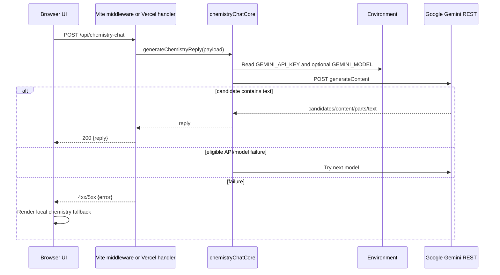

# Gemini API Integration

## Active Chemistry Doubt Bot path

### Frontend

`src/components/ChemistryDoubtBot.jsx` is the active chat interface. `sendQuestion` creates a user-message object, updates React state, sets `thinking`, and calls `askChemistryApi(text, history)`. The request is:

```text
POST /api/chemistry-chat
Content-Type: application/json
{ "message": "...", "history": [up to eight recent message objects] }
```

An `AbortController` enforces an 18-second client timeout. A response must be HTTP-successful and contain `reply`; otherwise the UI uses `buildChemistryAnswer`, a local keyword-based chemistry fallback. That fallback is why an API/network failure can look like a generic chatbot reply rather than a blank UI.

### Local and deployed route handlers

`vite.config.js` defines a `local-chemistry-chat-api` plugin. Its `configureServer` middleware accepts only POST, parses JSON with `readJsonBody`, calls `generateChemistryReply`, and returns `{reply}` or `{error}`.

`api/chemistry-chat.js` is the Vercel handler with equivalent method validation and calls to the same core. This is the endpoint expected in a deployment; it is not a browser-side Gemini call.

### Shared core

`api/chemistryChatCore.js` implements:

- `buildGeminiPrompt(message, history)`: applies chemistry-tutor instructions and serializes up to eight turns.
- `requestGeminiReply(...)`: uses `fetch` against Gemini REST `v1beta/models/{model}:generateContent`, with JSON content and generation config (`temperature: 0.35`, `maxOutputTokens: 550`).
- `extractGeminiText(data)`: gathers textual candidate parts.
- `generateChemistryReply(...)`: validates message/key, tries configured/default model then documented fallback-model sequence, and returns text or throws a status-bearing error.

Each Gemini request has a 15-second `AbortController` timeout. Missing key produces 503, bad input produces 400, and network/unknown errors are normalized to 504. The fallback sequence is retried for 404, 429, 500, 503 and 504 responses.



## Secret management

The source reads `GEMINI_API_KEY` from server environment, never from a Vite `VITE_*` variable and never sends it to the browser. `.env.local` is intentionally excluded from this documentation; its value must remain private. For Vercel, the same name must be configured in project environment settings. A key committed or pasted into public content should be replaced/rotated by its owner; this audit does not reveal it.

## Separate legacy Express integration

`organic-chemistry-visualizer/server/server.js` is a separately runnable backend on port 5000. It uses `@google/generative-ai`, Express, CORS, dotenv and multer. It provides:

- `POST /api/chat`: text/history and optional `image` multipart upload; calls Gemini with a detailed organic tutor system instruction.
- `POST /api/quiz/generate`: asks Gemini for JSON quiz questions, parses the result, adds IDs and returns them.

`organic-chemistry-visualizer/src/services/apiService.js` calls `http://localhost:5000/api`, retries failed requests twice with exponential delay, and distinguishes offline errors. This path supports `ChatPage.jsx` and AI quiz generation code, but `ChatPage.jsx` is not registered in the active root integrated route map. Thus it is **implemented but not confirmed as part of the active root navigation**.

## Security/operational limits visible in code

- API key remains server-side in both backend designs.
- The legacy Express server enables permissive CORS and uses in-memory upload buffers; no authentication, rate limiting, file-size configuration or persistent storage was found.
- Gemini model availability and quota can change externally; the root core handles several transient/model statuses through fallback but cannot guarantee service availability.
