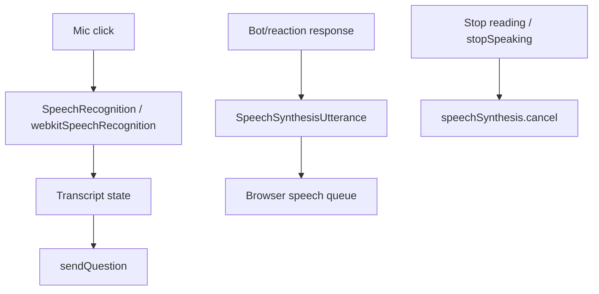

# Application Workflows

## 1. User opens the website

1. Browser loads root `index.html`, which contains `#root`, loads global 3Dmol bundle and module `/src/main.jsx`.
2. `main.jsx` calls `createRoot`, wraps `App` in `React.StrictMode` and `BrowserRouter`, and imports `styles.css`.
3. `App.jsx` mounts `ChemistryDoubtBot` and resolves current URL through `<Routes>`.
4. At `/`, `ChemistryUniverseHome` initially shows its timed loading overlay, then mounts R3F `<Canvas>` and animated portal buttons.

## 2–3. Navigate to periodic table and select an element

1. Landing portal uses a React Router `Link` to `/inorganic`.
2. Root lazy-loads `InorganicPlatform`; it renders `periodic table/src/App.tsx`.
3. `pathToView(window.location.pathname)` selects inorganic landing or periodic-table view. The landing/navbar invokes `navigateToView`, which updates component state and browser history.
4. `PeriodicTable` maps records from `data/elements.ts` to tiles. A tile click calls `onSelectElement(element)` supplied by `App.tsx`.
5. `handleSelectElement` resets orbital highlights and stores the selected `ChemicalElement` in `activeElement`.
6. The app switches to the selected-atom full-screen branch and lazy-loads `AtomViewer`; `InfoPanel`, `CloseButton` and `OrbitalControls` appear around it.

## 4–5. Open and interact with a molecular visualization

### Atomic model

`AtomViewer` receives element shells/protons/neutrons. It creates an R3F WebGL canvas, renders `Nucleus` and one `ElectronOrbit` per shell, and installs Drei `OrbitControls`. Dragging/scrolling is handled by OrbitControls. `OrbitalControls` updates `HighlightState`; orbit/electron materials adjust opacity and glow inside `useFrame`.

### Molecule display

Organic and inorganic molecule components mount an HTML container, ensure `/vendor/3Dmol-min.js` exists, call `createViewer`, add an authored XYZ model, apply styles, zoom and render. Organic display loops call `viewer.rotate` and `viewer.render`; component cleanup cancels the animation and clears the viewer. All molecule coordinates are local source data rather than a remote lookup.

## 6–7. Open AI chatbot and ask a question

1. User opens the persistent bot’s floating button.
2. Text Enter, send icon, quick prompt, or final speech transcript invokes `sendQuestion`.
3. React adds a user message, clears input and shows “Thinking through the chemistry...”.
4. `askChemistryApi` posts message and last eight message objects to `/api/chemistry-chat`.
5. Vite development middleware or Vercel handler calls shared `generateChemistryReply`.
6. Core reads environment on the server, builds a constrained chemistry tutor prompt, calls Gemini REST and extracts candidate text.
7. UI appends returned reply. Failed request appends the limited local keyword fallback instead.

## 8. Speech functionality

- Voice typing is captured by browser recognition; its final transcript follows the same chat request path as typed text.
- Root bot Read aloud creates an utterance for the answer; Stop reading cancels it.
- Organic reactions build multi-part narration queues and update display highlights while each segment speaks.
- Inorganic modules use their narration hook/controllers for educational text.

## State ownership summary

| State | Owner |
|---|---|
| Top-level active route | React Router, root `App.jsx` |
| Inorganic screen/path | `periodic table/src/App.tsx` state + History API |
| Selected element/highlight | Inorganic `App.tsx` |
| Organic category slug | React Router params in `CategoryPage` |
| Quiz progress/timer | `QuizArea` local state |
| Chat messages/request lifecycle | `ChemistryDoubtBot` local state |
| Root chat key/model | Server environment only |
