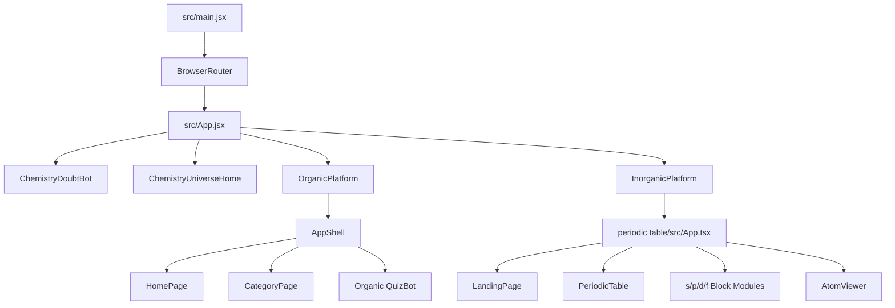
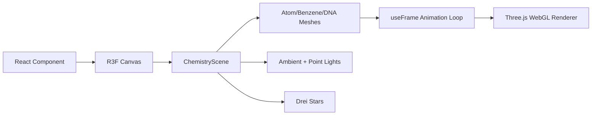
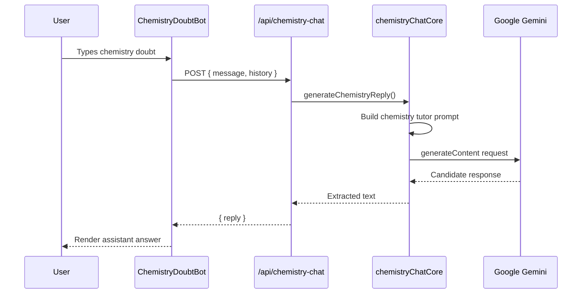
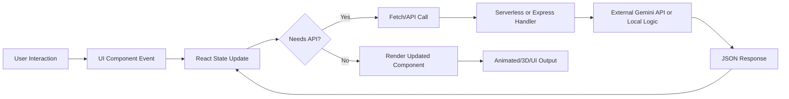
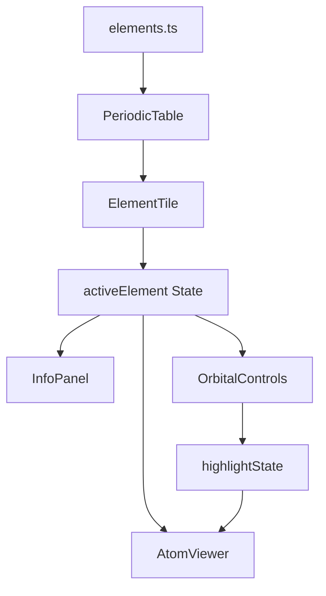
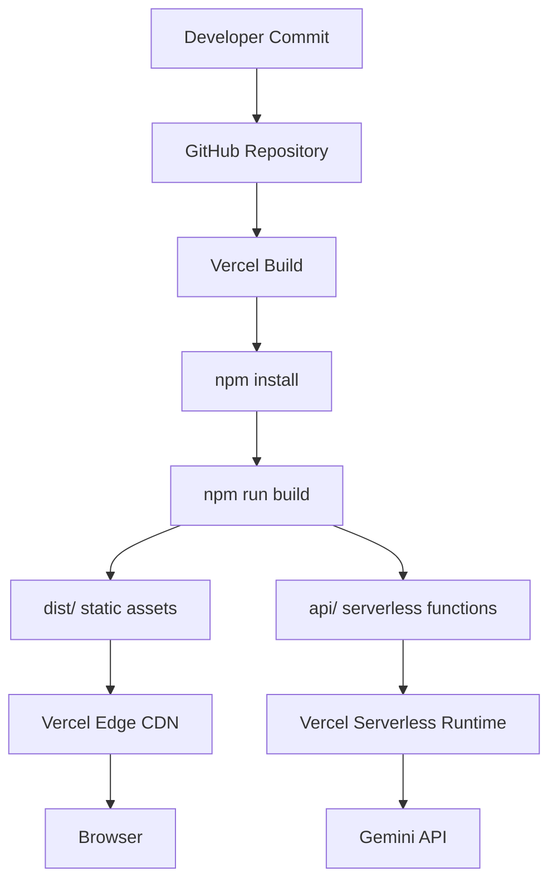

# Chemistry Universe - Technical Architecture

## 1. Project Overview

**Chemistry Universe** is an interactive chemistry learning platform built as a modern React/Vite single-page application. The project combines a neon-themed landing experience, organic chemistry visual learning, inorganic chemistry modules, 3D molecular/atomic rendering, quizzes, narration, and AI-assisted doubt clearing.

The current repository acts as a unified shell that integrates two large learning experiences:

- **Organic Chemistry section**: category-based organic chemistry lessons, molecule visualizations, reaction blocks, voice narration, chemistry quiz flow, and an optional Catalyst AI organic tutor.
- **Inorganic Chemistry section**: futuristic landing screen, interactive periodic table, element detail viewer, electron shell/orbital animations, s/p/d/f block modules, trend visualizers, real-world application cards, and an inorganic quiz bot.
- **3D molecule visualizations**: organic structures rendered with `3Dmol.js`; home/landing elements rendered with `@react-three/fiber`, `@react-three/drei`, and `three`.
- **Interactive periodic table**: element grid, category filtering, trend visualization, full-table reset, and element drill-down.
- **Electron shell animations**: atomic orbitals and shell highlights for selected elements and block modules.
- **Chemistry AI assistant/chatbot**: a global floating chemistry assistant backed by a Vercel/serverless Gemini API endpoint, with local fallback answers when the API is unavailable.
- **Quizzes and interactive learning**: organic and inorganic quiz bots, local quiz logic, optional Gemini-generated organic quiz questions through a local Express service.
- **Modern neon UI/UX**: glassmorphism, cyan/fuchsia glow effects, animated particles, route transitions, and responsive layouts.

At a high level, the platform is a Vite React app with nested integration of an organic visualizer app and an inorganic periodic-table app.

```mermaid
flowchart TD
  U[Student/User] --> B[Browser SPA]
  B --> R[React Router App Shell]
  R --> H[Chemistry Universe Home]
  R --> O[Organic Chemistry Platform]
  R --> I[Inorganic Chemistry Platform]
  R --> A[Global AI Chemistry Assistant]
  A --> API[/api/chemistry-chat]
  API --> G[Google Gemini API]
  O --> OQ[Organic Quiz Bot]
  O --> OV[3Dmol Molecule Viewer]
  I --> PT[Periodic Table]
  I --> AV[3D Atom Viewer]
  I --> BL[s/p/d/f Block Modules]
```

## 2. Technology Stack

| Layer | Technology | Purpose in Chemistry Universe |
|---|---|---|
| Frontend framework | React 19 | Component-based UI for the root shell, organic platform, and inorganic platform. |
| Language | JavaScript + TypeScript | Root and organic modules use JSX/JavaScript; inorganic module uses TypeScript/TSX. |
| Routing | `react-router-dom` v7 | Root route management for `/`, `/organic/*`, `/inorganic/*`, and redirect routes. Organic module also uses nested routes. |
| Build tool | Vite 8 | Development server, production bundling, module optimization, and custom dev middleware. |
| Package manager | npm | Dependency installation and script execution through `package.json` and `package-lock.json`. |
| Styling | Tailwind CSS 4, custom CSS | Utility-first layout and custom neon, grid, glow, and animation effects. |
| Icons | `lucide-react` | Chemistry, bot, navigation, quiz, and control icons. |
| Animation | `framer-motion` | Route transitions, cards, buttons, loading states, interactive panels, and animated UI states. |
| 3D rendering | `three`, `@react-three/fiber`, `@react-three/drei` | WebGL scenes for the main homepage and inorganic atom visualizations. |
| Molecule rendering | `3dmol` + `public/vendor/3Dmol-min.js` | Organic molecule/structure rendering from molecular coordinate data and SDF files. |
| AI assistant | Google Gemini REST API | Global chemistry doubt assistant through `/api/chemistry-chat`. |
| Optional organic AI backend | Express, CORS, Multer, `@google/generative-ai` | Local Catalyst AI tutor and AI quiz generation endpoints under `organic-chemistry-visualizer/server`. |
| State management | React hooks | Local component state with `useState`, `useEffect`, `useMemo`, `useRef`; no external global store. |
| Voice | Web Speech API | Speech recognition and text-to-speech narration with Indian English voice preference. |
| Deployment | Vercel-style SPA deployment | `vercel.json` rewrites routes to `index.html`; `api/` provides serverless endpoint. |
| Production bundling | Rollup via Vite | Manual vendor chunks for React, UI, and 3D dependencies. |

## 3. Folder Structure

The source-level project structure is:

```text
chem/
├── api/
│   ├── chemistry-chat.js
│   └── chemistryChatCore.js
├── public/
│   └── vendor/
│       └── 3Dmol-min.js
├── src/
│   ├── App.jsx
│   ├── main.jsx
│   ├── styles.css
│   ├── components/
│   │   ├── ChemistryDoubtBot.jsx
│   │   └── ChemistryUniverseHome.jsx
│   └── integrations/
│       ├── InorganicPlatform.jsx
│       └── OrganicPlatform.jsx
├── organic-chemistry-visualizer/
│   ├── public/
│   │   └── molecules/
│   │       ├── benzene.sdf
│   │       ├── ethanol.sdf
│   │       ├── methanol.sdf
│   │       └── phenol.sdf
│   ├── server/
│   │   ├── package.json
│   │   └── server.js
│   ├── src/
│   │   ├── components/
│   │   │   ├── cards/
│   │   │   ├── layout/
│   │   │   ├── molecule/
│   │   │   ├── navigation/
│   │   │   ├── quiz/
│   │   │   ├── reaction/
│   │   │   ├── sections/
│   │   │   ├── theme/
│   │   │   └── voice/
│   │   ├── data/
│   │   │   └── chemistryContent.js
│   │   ├── pages/
│   │   │   ├── CategoryPage.jsx
│   │   │   ├── ChatPage.jsx
│   │   │   └── HomePage.jsx
│   │   ├── routes/
│   │   │   └── AppRoutes.jsx
│   │   ├── services/
│   │   │   └── apiService.js
│   │   ├── index.css
│   │   └── main.jsx
│   ├── package.json
│   ├── tailwind.config.js
│   └── vite.config.js
├── periodic table/
│   ├── public/
│   │   ├── favicon.svg
│   │   └── icons.svg
│   ├── src/
│   │   ├── App.tsx
│   │   ├── main.tsx
│   │   ├── style.css
│   │   ├── components/
│   │   │   ├── chemistry/
│   │   │   ├── landing/
│   │   │   ├── quiz/
│   │   │   ├── AtomViewer.tsx
│   │   │   ├── CloseButton.tsx
│   │   │   ├── ElectronOrbit.tsx
│   │   │   ├── ElementTile.tsx
│   │   │   ├── InfoPanel.tsx
│   │   │   ├── OrbitalControls.tsx
│   │   │   ├── PeriodicTable.tsx
│   │   │   ├── PeriodicTrends.tsx
│   │   │   └── UnifiedFilterManager.tsx
│   │   ├── data/
│   │   │   └── elements.ts
│   │   ├── hooks/
│   │   │   └── useVoiceNarration.ts
│   │   └── utils/
│   │       └── orbitHelpers.ts
│   ├── package.json
│   ├── tsconfig.json
│   └── vite.config.ts
├── .env.example
├── index.html
├── package.json
├── package-lock.json
├── vercel.json
└── vite.config.js
```

Important folders and files:

| Path | Purpose |
|---|---|
| `src/App.jsx` | Root React route shell, global chatbot mount, lazy loading for organic and inorganic platforms. |
| `src/components/ChemistryUniverseHome.jsx` | Main neon landing/home page with 3D background scene and organic/inorganic entry cards. |
| `src/components/ChemistryDoubtBot.jsx` | Floating global chemistry assistant UI and client-side fallback logic. |
| `src/integrations/OrganicPlatform.jsx` | Wraps the organic visualizer as nested React Router routes. |
| `src/integrations/InorganicPlatform.jsx` | Embeds the inorganic periodic-table TypeScript app into the root app. |
| `api/chemistry-chat.js` | Vercel/serverless POST endpoint for the global AI assistant. |
| `api/chemistryChatCore.js` | Gemini prompt construction, history serialization, model request, and response extraction. |
| `vite.config.js` | Root Vite configuration, local `/api/chemistry-chat` dev middleware, dependency dedupe, and manual chunks. |
| `vercel.json` | SPA fallback rewrites so client-side routes work in production. |
| `organic-chemistry-visualizer/src/data/chemistryContent.js` | Structured organic lesson content, categories, reactions, molecular data. |
| `organic-chemistry-visualizer/server/server.js` | Optional Express backend for Catalyst AI chat, image upload, and AI quiz generation. |
| `periodic table/src/data/elements.ts` | Main inorganic element dataset for the periodic table and atom views. |
| `periodic table/src/components/chemistry/` | s/p/d/f block dashboards, trend modules, application cards, and educational UI. |
| `public/vendor/3Dmol-min.js` | Browser bundle used to render organic molecules. |

Generated and dependency folders such as `node_modules/` and `dist/` are build/runtime artifacts and should not be treated as source architecture.

## 4. Frontend Architecture

### Component Architecture

The frontend is organized as a root application shell plus two integrated sub-applications.



The root layer handles cross-platform responsibilities:

- Global routing.
- Global floating AI assistant.
- Lazy-loaded organic/inorganic platform bundles.
- Route loading fallback.
- Route error boundary.

The organic layer handles:

- Organic category landing page.
- Functional-group lessons.
- Reaction sections.
- Molecule visualizations.
- Organic quiz bot.
- Optional Catalyst AI chat page and local AI backend integration.

The inorganic layer handles:

- Inorganic landing page.
- Periodic table view.
- Element detail screen.
- Atomic orbital controls.
- s/p/d/f block learning dashboards.
- Inorganic quiz bot.

### Page Routing Flow

Root routes:

| Route | Component | Behavior |
|---|---|---|
| `/` | `ChemistryUniverseHome` | Neon main homepage and entry point. |
| `/organic/*` | `OrganicPlatform` | Lazy-loaded organic chemistry module. |
| `/inorganic/*` | `InorganicPlatform` | Lazy-loaded inorganic chemistry module. |
| `/periodic-table` | Redirect | Redirects to `/inorganic/periodic-table`. |
| `*` | Redirect | Sends unknown routes to `/`. |

Organic nested routes:

| Route | Component | Behavior |
|---|---|---|
| `/organic` | `HomePage` | Organic platform home with category cards. |
| `/organic/:categorySlug` | `CategoryPage` | Category-specific organic lesson content. |

Inorganic navigation is state-driven inside `periodic table/src/App.tsx`, with path synchronization through `window.history.pushState`:

| Path | View State |
|---|---|
| `/inorganic` | landing |
| `/inorganic/periodic-table` | periodic-table |
| `/inorganic/s-block` | s-block |
| `/inorganic/p-block` | p-block |
| `/inorganic/d-block` | d-block |
| `/inorganic/f-block` | f-block |

### Reusable UI Components

Reusable UI patterns include:

- Card components: category cards, application cards, compound cards, quiz cards.
- Layout shells: organic `AppShell`, root app shell, inorganic view wrappers.
- Navigation controls: organic theme toggle, inorganic futuristic navbar, block-section return buttons.
- Visualization components: `MoleculeViewer`, `AtomViewer`, `ElectronOrbit`, `ElementTile`.
- Voice controls: `VoiceButton`, `SpeechController`, `VoiceNarrator`, `useVoiceNarration`.
- Quiz components: `QuizBot`, `QuizArea`, `QuizResults`, `InorganicQuizBot`.

### State Management Flow

The application uses local React state rather than a global store:

- `src/App.jsx`: route-level lazy loading and global chatbot mount.
- `ChemistryDoubtBot`: open/closed state, input, messages, thinking state, speech recognition state.
- Inorganic `App.tsx`: current view, active element, hovered category, orbital highlight state.
- Periodic table: clicked category, active trend, narration mute state.
- Block modules: selected section/group/family, active element, active shell/configuration token, application narration state.
- Organic quiz/chat: sessions, messages, active quiz, quiz results, upload state.

This model keeps state scoped to the view that owns it, which is appropriate for an educational SPA with mostly independent modules.

### Responsive Design Strategy

Responsive behavior is primarily implemented with Tailwind breakpoint utilities:

- Mobile-first layouts with column stacking.
- Desktop grids for cards and dashboards.
- Horizontal overflow for complex scientific grids.
- Fixed-format controls for periodic table and orbital UIs.
- `min()`, fixed dimensions, and responsive grid classes to prevent layout shifts.

### Theme System

There are two theme layers:

- Root/home/inorganic: predominantly dark neon design with cyan, purple, and fuchsia accents.
- Organic: light/dark mode controlled by `ThemeToggle`, persisted in `localStorage` and applied through the `dark` class on `document.documentElement`.

### Animation Pipeline

Animations use:

- `framer-motion` for route transitions, cards, hover states, modals, panels, and animated application cards.
- CSS keyframes for background particles, scan lines, and grid effects.
- Three.js animation loops through `useFrame` for 3D rotations and floating molecules.
- Web Speech API events to highlight currently narrated reaction/application segments.

### User Interaction Flow

Typical user flows:

1. User lands on `/`.
2. User selects Organic or Inorganic.
3. Lazy-loaded platform module renders.
4. User selects category, element, periodic block, quiz, or chatbot.
5. Component-level state updates.
6. UI animates into the relevant lesson, 3D view, quiz, or AI response.

## 5. 3D Visualization System

Chemistry Universe uses two 3D pipelines.

### 5.1 Main Homepage Three.js Scene

`ChemistryUniverseHome.jsx` uses:

- `Canvas` from `@react-three/fiber`.
- `Float`, `Line`, `Stars`, and `Text` from `@react-three/drei`.
- `three` primitives and materials.

The scene includes:

- Atom models.
- Benzene ring wireframes.
- DNA-like helix fragments.
- Floating element cards.
- Star field and point lights.
- Pointer-responsive camera/rig rotation.

Rendering flow:



### 5.2 Organic Molecule Rendering

Organic molecule rendering uses `3Dmol.js`:

- `public/vendor/3Dmol-min.js` provides the browser bundle.
- Organic molecule data comes from inline XYZ data and public SDF files.
- `MoleculeViewer.jsx` and homepage molecule widgets initialize a 3Dmol viewer.
- Styles are applied for sticks/spheres with element-specific colors.
- `requestAnimationFrame` is used for slow rotation.

Organic rendering characteristics:

- Transparent viewer background.
- Stick/sphere visualization.
- Custom colors for C, H, O, N, S, P, halogens, and metals.
- Graceful "3D unavailable" fallback if 3Dmol fails.

### 5.3 Inorganic Atom and Electron Shell Rendering

Inorganic atom visualization uses Three.js/R3F components:

- `AtomViewer.tsx`
- `ElectronOrbit.tsx`
- `Nucleus.tsx`
- `OrbitalControls.tsx`
- `orbitHelpers.ts`

The renderer visualizes:

- Nucleus particles.
- Electron shells.
- Electron movement along orbital paths.
- Highlight filters for shell/subshell focus.
- Element-specific configuration and shell data from `elements.ts`.

### 5.4 Camera Controls and Interactions

The project uses guided/cinematic camera behavior rather than exposing heavy manual controls everywhere:

- Main home scene reacts subtly to pointer movement.
- Molecule viewers auto-rotate for passive learning.
- Inorganic element view provides UI-driven shell/subshell highlights.
- Close buttons and panels sit above the 3D layer using z-index overlays.

### 5.5 Performance Optimizations in 3D

Implemented optimizations include:

- Lazy loading `AtomViewer`.
- Manual Vite chunking for `vendor-3d`.
- Excluding `3dmol` from dependency optimization due to its browser bundle usage.
- Controlled DPR for homepage Canvas: `dpr={[1, 1.7]}`.
- Memoized geometry data where appropriate.
- Suspense fallback for 3D modules.
- Error boundaries for WebGL failures.

## 6. AI Assistant Architecture

Chemistry Universe contains two AI-related systems.

### 6.1 Global AI Chemistry Assistant

The global assistant is implemented in `src/components/ChemistryDoubtBot.jsx`.

Key responsibilities:

- Floating bot button available across all routes.
- Chat panel with starter prompts.
- Voice input through browser Speech Recognition.
- API call to `/api/chemistry-chat`.
- Fallback local chemistry answers when the API is unavailable.

Server/API implementation:

- `api/chemistry-chat.js`: Vercel-compatible serverless handler.
- `api/chemistryChatCore.js`: shared Gemini request logic.
- `vite.config.js`: local dev middleware that serves `/api/chemistry-chat` during `npm run dev`.

Prompt flow:



Context management:

- The client sends recent history.
- The server trims history to the latest eight messages.
- Prompt maps `user` to `Student` and bot replies to `Tutor`.
- Generation uses low temperature (`0.35`) and a token cap (`550`) for concise academic answers.

Fallback handling:

- If `/api/chemistry-chat` fails, the bot uses deterministic local answers for common chemistry topics such as SN1/SN2, lanthanide contraction, trends, acidity/basicity, Grignard reagents, coordination chemistry, and haloalkanes/haloarenes.

### 6.2 Organic Catalyst AI Backend

The organic visualizer includes an optional Express backend in `organic-chemistry-visualizer/server/server.js`.

Capabilities:

- `POST /api/chat`
  - Gemini-backed organic chemistry tutor.
  - Supports text, history, and image upload with `multer`.
  - Uses a detailed IIT-JEE/NEET organic chemistry system instruction.
- `POST /api/quiz/generate`
  - Generates 10-question quiz JSON from chapter content.
  - Parses and validates model output.

The organic frontend service client lives in `organic-chemistry-visualizer/src/services/apiService.js` and points to:

```text
http://localhost:5000/api
```

This backend is separate from the root Vercel endpoint and is intended for local/optional AI tutor and quiz generation workflows.

### Future AI Scalability

Potential improvements:

- Centralize all AI endpoints under one API layer.
- Add rate limiting per IP/session.
- Persist user chat history in a database.
- Add retrieval-augmented generation over structured chemistry content.
- Add streaming responses.
- Add model observability and prompt versioning.
- Add moderation filters and stricter chemistry-domain validation.

## 7. Data Flow Architecture

### User Interaction to Rendering Flow



### Organic Lesson Data Flow

```mermaid
flowchart TD
  CategoryRoute[/organic/:categorySlug] --> Content[chemistryContent.js]
  Content --> Page[CategoryPage]
  Page --> Sections[Introduction, Reactions, Tests, Conversions]
  Sections --> Molecules[3Dmol / Reaction Visualization]
  Sections --> Voice[SpeechController + VoiceButton]
  Sections --> Quiz[QuizBot / quizService]
```

### Inorganic Periodic Table Data Flow



### AI Chat Data Flow

```mermaid
flowchart TD
  Input[User message] --> Bot[ChemistryDoubtBot]
  Bot --> History[Last messages]
  History --> Endpoint[/api/chemistry-chat]
  Endpoint --> Prompt[Gemini prompt builder]
  Prompt --> Gemini[Gemini generateContent]
  Gemini --> Reply[Text reply]
  Reply --> Bot
  Bot --> Render[Chat bubbles]
```

## 8. UI/UX Architecture

### Neon Theme System

The visual language is built around:

- Dark cosmic backgrounds.
- Cyan/fuchsia/purple gradients.
- Glow-heavy text shadows.
- Glassmorphism panels.
- Grid overlays and scan lines.
- High-contrast cards and controls.
- Scientific/cyber typography using Orbitron, Space Grotesk, Inter, Outfit, and Share Tech Mono.

### Layout Hierarchy

Root homepage:

1. Global assistant trigger.
2. Animated 3D background layer.
3. Gradient/grid/particle overlays.
4. Brand/name header.
5. Central title and module selection cards.
6. Footer credit.

Organic platform:

1. Sticky top navbar with theme toggle.
2. Organic home/lesson content.
3. Floating quiz bot.
4. Category-driven lesson sections.

Inorganic platform:

1. Landing page with module cards.
2. State-driven views for periodic table and blocks.
3. Full-screen element detail mode.
4. Floating inorganic quiz bot.
5. Block dashboards with return buttons and application narration.

### Navigation Structure

Navigation is intentionally simple:

- Main homepage routes users to Organic or Inorganic.
- Organic uses category cards and nested routes.
- Inorganic uses a stateful navigation model tied to URL paths.
- s/p/d/f block modules include top-left return buttons to move back to section selection.
- Periodic table includes a full-table reset button.

### Accessibility Considerations

Current accessibility strengths:

- Semantic buttons for interactive controls.
- `alt` text on application card images.
- Titles/tooltips on assistant and voice controls.
- Keyboard-capable inputs and buttons.
- High-contrast dark UI.

Areas for improvement:

- Add visible focus styles consistently.
- Add ARIA labels to icon-only controls where missing.
- Add reduced-motion support for animation-heavy views.
- Add captions/transcripts for narrated content.
- Ensure all generated quiz content has accessible structure.

### Animation Philosophy

Animations are used to reinforce learning state rather than purely decorate:

- Route transitions help users understand navigation changes.
- Hover effects make cards feel interactive.
- Atom/orbital animations visualize abstract chemistry concepts.
- Narration highlights guide attention through reactions or applications.
- Loading animations mask lazy-load and 3D setup delays.

### User Engagement Techniques

- Interactive periodic table scanning.
- Real-world applications in block modules.
- Voice narration and voice input.
- Quizzes with results and feedback.
- AI assistant for immediate doubt clearing.
- 3D molecules and animated electron models.

## 9. Performance Optimization

### Lazy Loading

Implemented:

- `OrganicPlatform` and `InorganicPlatform` are lazy-loaded in the root `App.jsx`.
- Inorganic `AtomViewer` is lazy-loaded with Suspense.
- Route-level loading spinners reduce blank-screen perception.

### Code Splitting

Root `vite.config.js` manually splits large vendors:

| Chunk | Contents |
|---|---|
| `vendor-3d` | `three`, `@react-three/*` |
| `vendor-react` | React and React Router |
| `vendor-ui` | Framer Motion and Lucide icons |

This improves caching and avoids bundling all dependencies into a single monolithic file.

### Asset Optimization

Current approach:

- Remote Unsplash images for application cards.
- Local SDF molecule assets.
- Public vendor copy of 3Dmol.
- Production Vite minification and tree-shaking.

Recommended improvements:

- Replace remote images with curated local optimized images for reliability.
- Convert large static images to WebP/AVIF.
- Add explicit image dimensions to reduce layout shift.
- Use a CDN or Vercel image optimization if deployed publicly.

### 3D Rendering Optimization

Current optimizations:

- Controlled device pixel ratio.
- Lazy-loaded heavy 3D views.
- Memoized geometry point arrays.
- Error boundary for WebGL failures.
- Minimal material complexity in many educational views.

Recommended improvements:

- Pause 3D animation when tabs are hidden.
- Respect `prefers-reduced-motion`.
- Dispose geometries/materials explicitly where custom meshes are frequently mounted.
- Add performance profiles for low-end devices.

### Animation Optimization

Current:

- Framer Motion is used for transform/opacity-heavy animations.
- CSS keyframes handle background effects.
- Layout shifts are reduced using fixed grid/card dimensions in key areas.

Recommended:

- Avoid animating expensive layout properties.
- Reduce background particle density on mobile.
- Add reduced-motion variants.

### API Optimization

Current:

- Organic API client has retry with exponential backoff.
- Global assistant sends only recent history.
- Token cap limits response size.

Recommended:

- Add rate limiting.
- Add response streaming.
- Cache common static/fallback answers.
- Add server-side request timeout handling.

### Caching Strategies

Currently available:

- Browser cache for built vendor chunks.
- Vite production chunk hashing.
- Remote image caching through image host/CDN.

Future:

- Service worker for static app shell.
- IndexedDB/localStorage for quiz progress and chat sessions.
- CDN caching for public assets.

## 10. Security Considerations

### API Key Protection

The project uses `GEMINI_API_KEY` and `GEMINI_MODEL`.

Important security note:

- `.env.example` currently contains a real-looking Gemini key value. Treat that key as exposed, rotate it, and replace the example with a placeholder such as:

```text
GEMINI_API_KEY=your_gemini_api_key_here
GEMINI_MODEL=gemini-2.5-flash-lite
```

Best practices:

- Never commit real API keys.
- Configure production secrets in Vercel environment variables.
- Keep AI calls server-side.
- Avoid exposing `GEMINI_API_KEY` through `VITE_` variables.

### Environment Variables

Root AI endpoint:

| Variable | Purpose |
|---|---|
| `GEMINI_API_KEY` | Required for global assistant Gemini calls. |
| `GEMINI_MODEL` | Optional model override, defaults to `gemini-2.5-flash-lite`. |

Organic Express backend:

| Variable | Purpose |
|---|---|
| `GEMINI_API_KEY` | Required for Catalyst AI and AI quiz generation. |
| `PORT` | Optional local server port, defaults to `5000`. |

### Input Validation

Current validation:

- Global assistant rejects non-POST requests.
- Global assistant requires a string `message`.
- Organic quiz endpoint requires `topicContent`.
- File uploads use in-memory `multer`.

Recommended hardening:

- Limit message length.
- Limit upload file size and MIME types.
- Add schema validation with Zod/Yup.
- Sanitize rendered model output before using `dangerouslySetInnerHTML`.
- Validate AI-generated quiz JSON strictly before rendering.

### Secure Deployment Practices

Recommended:

- Rotate exposed keys.
- Use Vercel encrypted environment variables.
- Keep `.env.local` ignored.
- Add CORS restrictions for Express backend if exposed publicly.
- Add rate limits to AI endpoints.
- Add request logging without storing sensitive prompts unnecessarily.

### Rate Limiting Possibilities

Recommended controls:

- Per-IP request limits.
- Per-session AI quota.
- Captcha or abuse protection for public deployment.
- Queueing/backpressure for Gemini calls.
- Separate limits for chat, quiz generation, and image upload.

## 11. Deployment Architecture

### GitHub Integration

Recommended production flow:

1. Push source code to GitHub.
2. Connect the repository to Vercel.
3. Configure Vercel build command: `npm run build`.
4. Configure output directory: `dist`.
5. Add environment variables in Vercel dashboard.
6. Deploy preview builds for pull requests and production builds for main branch.

### Vercel Deployment Flow



### Build Process

The root build runs:

```bash
npm run build
```

This executes:

```bash
vite build
```

Vite then:

- Transforms React/TSX/JSX modules.
- Processes Tailwind CSS sources from root, organic, and inorganic directories.
- Splits vendor chunks.
- Produces hashed static assets in `dist/`.
- Leaves `api/` available for Vercel serverless deployment.

### Production Pipeline

Production runtime consists of:

- Static Vite SPA served from `dist/`.
- Client-side routing through React Router.
- `vercel.json` rewrite fallback to `index.html`.
- `/api/chemistry-chat` serverless endpoint.
- Gemini API as external AI dependency.

`vercel.json`:

```json
{
  "rewrites": [
    {
      "source": "/(.*)",
      "destination": "/index.html"
    }
  ]
}
```

This ensures routes such as `/organic/alkanes` and `/inorganic/periodic-table` load correctly on refresh.

### Environment Configuration

Production must define:

```text
GEMINI_API_KEY=<server-side secret>
GEMINI_MODEL=gemini-2.5-flash-lite
```

Optional local organic AI server:

```bash
cd organic-chemistry-visualizer/server
npm install
npm run dev
```

The organic AI frontend expects:

```text
http://localhost:5000/api
```

## 12. Scalability & Future Enhancements

Recommended future improvements:

- **AR/VR chemistry labs**: immersive molecular geometry, reaction simulations, and virtual lab safety scenarios.
- **Multiplayer learning**: shared quizzes, classroom sessions, team-based reaction prediction challenges.
- **AI-generated quizzes**: centralize AI quiz generation for both organic and inorganic modules.
- **Voice assistant**: conversational speech-to-speech chemistry tutor with Indian English voice profiles.
- **Personalized learning dashboard**: track chapter progress, quiz scores, weak concepts, and recommended revision.
- **Cloud database integration**: store users, sessions, quiz attempts, bookmarks, and learning analytics.
- **Progress tracking**: local-first progress now, cloud sync later.
- **RAG-based AI tutor**: ground AI responses in curated chemistry content from the platform.
- **Image generation/diagram assistant**: generate mechanisms, orbital diagrams, and electron-flow explanations.
- **Offline mode**: cache lessons, quizzes, and periodic table data.
- **Admin content management**: structured content editor for reactions, compounds, applications, and quizzes.
- **Testing pipeline**: add unit tests for data utilities, component tests for modules, and Playwright tests for critical flows.
- **Observability**: error tracking, WebGL failure analytics, AI endpoint metrics, and user flow telemetry.

## 13. Conclusion

Chemistry Universe is architected as a rich educational React platform with modular organic and inorganic learning experiences unified under a single Vite application shell. Its technical strengths are:

- A clear separation between root shell, organic platform, and inorganic platform.
- Strong use of visual learning through 3D molecule and atomic rendering.
- Engaging UI built with Tailwind CSS, Framer Motion, and neon/glassmorphism design.
- AI-assisted doubt clearing through a server-side Gemini integration.
- Flexible quiz architecture with both local and optional AI-generated quiz flows.
- Deployment-ready SPA configuration for Vercel.
- Performance-aware lazy loading and vendor code splitting for large 3D dependencies.

The platform is already well-positioned for presentation as an advanced interactive chemistry learning environment. With improved secret hygiene, centralized AI services, stronger accessibility coverage, and persistent user progress, it can scale into a robust personalized chemistry education product.
